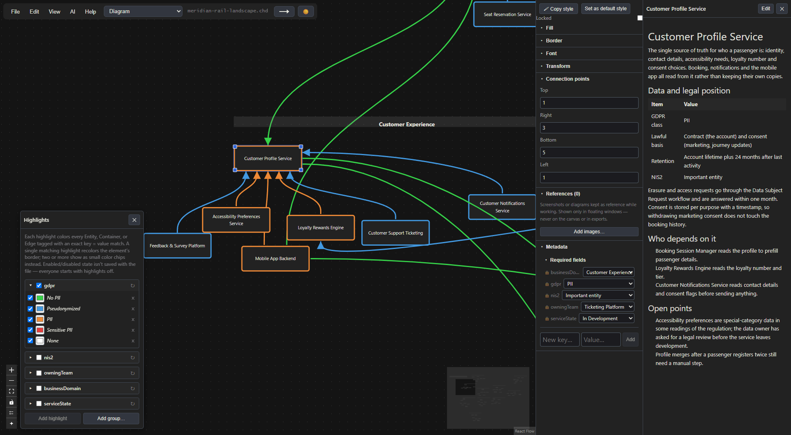
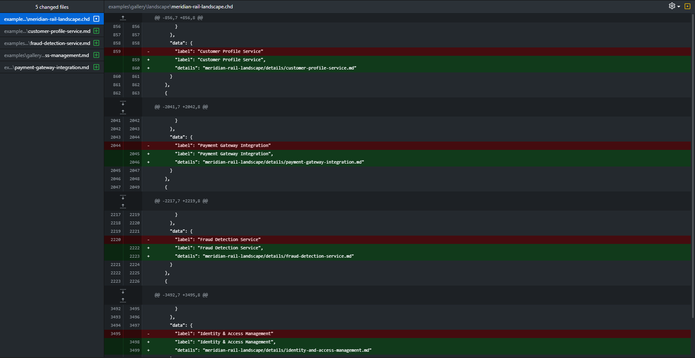

# Context Heavy Diagrams

**An offline desktop diagramming tool. Diagrams are plain-text files that diff cleanly in git, and every box can carry notes, tags, images and a link to a deeper diagram. The canvas stays readable while the context lives behind it.**

> **Early open-source release (0.x).** It is built and tested mainly on Windows. Linux and macOS are supported targets but not yet verified, and there are no prebuilt downloads yet, so you build it from source (below). File compatibility is a priority, but expect rough edges. `1.0.0` is reserved for when the tool is feature-complete.



https://github.com/user-attachments/assets/50d4d6b5-6aeb-47e9-b7b5-9f252e3970c4

*Drill down through linked diagrams, then add a highlight from the tags that are shown. The same rules apply as the features interact.*

## Why another diagramming tool?

Commercial diagramming tools are restrictive, and general box-and-arrow editors make you pay for flexibility with fiddly mechanics: overlapping objects you have to move together, arrows that don't follow when you move a box, groups that fight you when you edit one part. Context Heavy Diagrams is built around a few rules instead:

- **A node is one thing.** Notes, links, tags and icons are fields *on* the node, never separate objects you have to keep aligned.
- **Edges are always attached.** They are bound to connection points and re-route when anything moves or resizes.
- **Context goes behind the box, not on top of it.** Long explanations live in a Markdown notes panel, deeper structure lives in a linked diagram, and the canvas stays a readable overview.
- **Your files are yours.** Plain, gitable and deterministic JSON on disk; no server, no account, no network.

For a comparison with other diagram tools, see [the comparison](docs/comparison.md).

## Features

Suits many kinds of diagrams, such as customer journeys, organisation goals and data models; see the [gallery](examples/gallery/README.md).

### Local and offline
- **Works fully offline.** No server, no account, no sign-in. The app blocks its own network access, so this is enforced, not just promised ([ADR 0113](docs/decisions/0113-enforced-offline-behaviour.md)).
- **Autosave and crash recovery**, light and dark themes, native file dialogs, and `.chd` files that open on double-click (Windows installer).
- **One window per diagram**, with undo/redo, clipboard copy/paste across windows, and a command palette (Ctrl/Cmd+K).

### Git-friendly



*Adding notes to four entities is four changed lines in the diagram, plus the new note files.*

A diagram is a small, deterministic text file, so git can do for it what it does for code:

- **History you can rewind.** Every change is a small diff with a commit message saying why, and you can check out any earlier state of a diagram and open it.
- **Review and branching.** Propose a change to an architecture in a pull request, compare branches, and merge, like any other change.
- **Diagrams that live with the code.** Keep the diagram and its notes in the same repository as the code, so they change in the same commit, get reviewed together and evolve together instead of drifting apart.

- **Plain-text `.chd` files:** deterministic JSON with a fixed key order and no embedded binaries, built to diff and merge like source code.
- **The format is a standalone spec** ([docs/file-format.md](docs/file-format.md)). A third party can read or write it without this codebase.
- **Deterministic generation of renders.** Any `.chd` file can reproduce the identical PNG with an auto-generated legend, saving you from bundling expensive blobs.

### Drill-down diagrams and hidden context
- **Linked diagrams.** A node can link to another `.chd`, and Ctrl/Cmd-click opens it. Links only point downward, so any diagram in a tree opens as its own root.
- **Per-node notes** in Markdown, shown in a side panel.
- **Reference images** pinned to a node, shown in floating zoomable windows.
- **Search** with a small query language (`tag:env=prod`, `has:details`, and more), optionally drilling into linked diagrams, with an isolate mode that dims everything else.

### Tags, highlights and views

https://github.com/user-attachments/assets/2e63dee5-85f8-4b32-a75a-f986084bd873

*Highlighting by tag: metadata fields such as GDPR and owning team colour the elements.*

- **A unified tag system** with free tags and diagram-defined *required* tags that have allowed values.
- **Highlights and a legend.** Colour elements by tag value, group them, and keep several sets side by side.
- **A security matrix view,** a threat/risk matrix over your entities whose scores roll up through linked diagrams (try [`security-rollup`](examples/gallery/technical/security-rollup/README.md)).
- **Diagnostics** that flag problems such as missing files or an empty legend, plus a **layer panel** and a **minimap** for big diagrams.

### Elements, connections and styling
- Entities, nestable **containers**, rotatable **text**, and freeform **curved lines**.
- About 5,800 bundled [Tabler](https://tabler.io/icons) icons (MIT) plus your own SVG/PNG icons, in up to four corner slots per entity.
- **Configurable connection points**, straight, step, smooth and curved routing, manual bend points, direction sets, and multi-connection wiring.
- A full **style panel**, named style palettes you can share, alignment guides, snapping, align/distribute, and multi-select resize.

### And more
- Legend and tag-based highlights (including grouped ones)
- Named style palettes for brand colours, fonts and default styles
- Edge direction sets
- Per-element lock
- Format painter
- Alt+drag duplicate and bulk create
- Isolate mode
- Search by tag, string, metadata, and icon, with a deep search toggle
- Peek card
- Required tags that propagate to children
- Paste with retargeted paths
- External change detection
- File-version warning
- Recent diagrams and shortcuts help
- The `chd` command line tool

> Advanced features are opt-in. A new diagram behaves like plain boxes and arrows until you reach for more ([ADR 0054](docs/decisions/0054-progressive-disclosure-for-advanced-features.md)).

## Try it

You need [Node.js](https://nodejs.org/) (a recent LTS or current release, developed on Node 24) and git. There is no database, no external service and no native compile step.

```bash
git clone https://github.com/NoobsDeSroobs/context-heavy-diagrams.git
cd context-heavy-diagrams
npm install
npm run dev
```

Then open a file from [`examples/`](examples/README.md) with **File → Open**, or drop it onto the window. (Double-clicking a `.chd` in your file manager only works with an installed build: the Windows installer offers to associate the file type, and Linux and macOS are unverified. A dev run from source never registers it.) `hello-world.chd` is the smallest example, and the [getting-started guide](docs/getting-started.md) walks through drawing your first diagram. The [gallery](examples/gallery/README.md) has a full fictional rail operator's landscape, a C4 drill-down, a customer journey, a Power BI star schema and more.

Other scripts: `npm test`, `npm run typecheck`, `npm run lint`. To build an installer for your own machine run `npm run build:win`, `build:mac` or `build:linux` (see [packaging](docs/architecture/packaging.md)). In VS Code, the **Debug All** launch configuration attaches to both the main and renderer processes.

## Working with AI assistants

An **AI** menu helps an assistant (Claude or another) read and write your diagrams safely: copy-paste instructions for a plain chat, a skill and `AGENTS.md` for agents working in a folder, a `chd` command-line tool to validate files, and a local extension for Claude Desktop. Everything runs locally and writes are guarded by a stale-edit check, but whatever an assistant reads is sent to its provider. Details are in [docs/architecture/ai-integration.md](docs/architecture/ai-integration.md). The menu can be switched off in Preferences.

## Documentation

- [`docs/getting-started.md`](docs/getting-started.md): a ten-minute tour of the app.
- [`docs/file-format.md`](docs/file-format.md): the `.chd` format specification.
- [`docs/architecture/`](docs/architecture/overview.md): purpose, design principles, components, packaging.
- [`docs/decisions/`](docs/decisions/): one short record per significant design decision, covering what was decided, why, and what else was considered.
- [`docs/planning/`](docs/planning/README.md): the backlog, as epics with task checklists. [`docs/known-issues.md`](docs/known-issues.md) lists real bugs found along the way.
- [`docs/project-brief.md`](docs/project-brief.md): the original requirements.

## Project status

This is the first open-source release of a project that was developed privately until now. The decision records and epics in `docs/` are the real history of how it got here, and they are published as they were written, on purpose, so the backlog is candid. The `.chd` format is at version 1 and changes are additive. Each file records the app version that last saved it, and the app warns when it opens a file saved by a newer version ([ADR 0118](docs/decisions/0118-saved-with-version-marker.md)).

## AI-assisted development

A large share of the code, especially the user interface, was written by an AI assistant working under the author's direction. Code the author writes by hand also goes through an AI review pass to check for potential issues. In either case the author sets the requirements, makes and records the design decisions, and tests the result. The [decision records](docs/decisions/) show the reasoning behind those choices. If you contribute, AI-assisted contributions are fine, but you are responsible for understanding and testing what you submit.

## Contributing

This is a personal tool, built for the author's own use: forks are welcome, and suggestions are welcome, but the author alone decides what goes in and how it works. A good argument can change that decision. See [CONTRIBUTING.md](CONTRIBUTING.md), including the terms under which contributions are given, and please open an issue before writing code. Bug reports and feedback are very welcome. Security problems go to [SECURITY.md](SECURITY.md), not a public issue.

## License

Copyright © 2026 Magnus Elden. Licensed under [GPL-3.0-or-later](LICENSE). You may use, modify and redistribute it, including commercially, as long as derivative works you distribute are released under the same license with source. Third-party components and their licenses are listed in [THIRD-PARTY-NOTICES.md](THIRD-PARTY-NOTICES.md).
